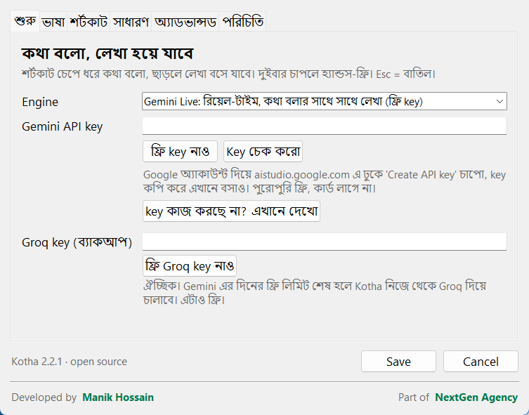
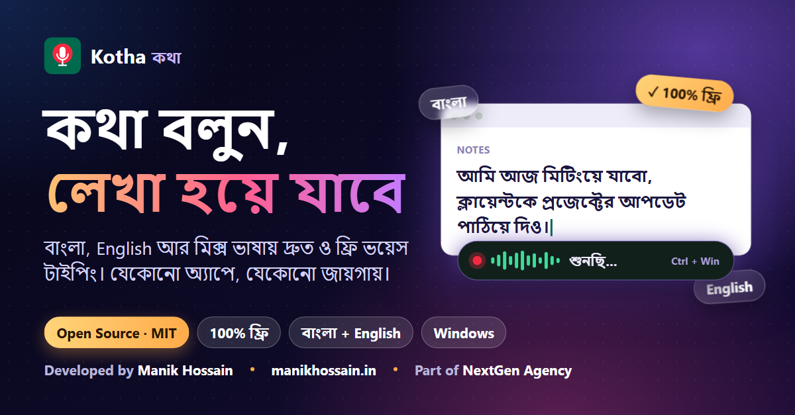
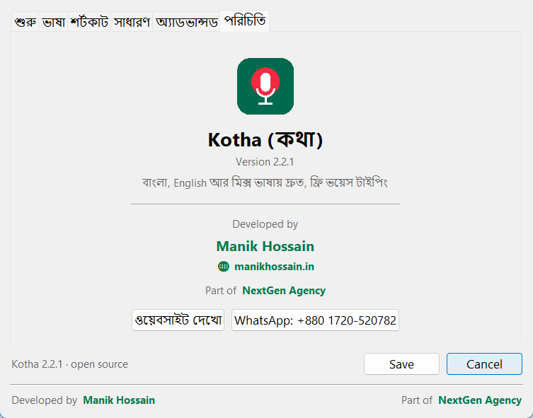

<div align="center">


# Kotha (কথা)

**Free, open-source voice typing and AI meeting notes for Windows (voice typing on macOS too). Speak Bangla, English, or a natural mix of both, and the text appears wherever your cursor is.**

কথা বলুন, লেখা হয়ে যাবে।

[](../../releases/latest/download/Kotha-Windows-Setup.exe)
[-000000?style=for-the-badge&logo=apple)](../../releases/latest/download/Kotha-Mac-AppleSilicon.dmg)
[](../../releases/latest/download/Kotha-Windows-Offline-Setup.exe)
[](LICENSE)


</div>

## Why Kotha

- **Bangla first.** Built for people who think in Bangla and write in a mix of Bangla and English. 85+ languages are supported.
- **Works everywhere.** Notepad, Word, WhatsApp Web, Gmail, VS Code, any text box. Kotha types the text for you. Windows and macOS.
- **Fast.** Long speech is sent in pieces while you are still talking, the connection is opened the moment you press the shortcut, and silence is trimmed before upload.
- **Free.** Uses a free Gemini API key. No card, no subscription.
- **Open source.** MIT licensed. Read the code, change it, build it yourself.
- **Private by choice.** Your key stays on your PC. Need fully offline dictation? Use the Offline edition.

## Download

Get the latest installers from the **[Releases page](../../releases/latest)**.

| File | System | Use it when |
|---|---|---|
| [`Kotha-Windows-Setup.exe`](../../releases/latest/download/Kotha-Windows-Setup.exe) | Windows 10/11 | Recommended. Uses Gemini with a free API key. |
| [`Kotha-Windows-Offline-Setup.exe`](../../releases/latest/download/Kotha-Windows-Offline-Setup.exe) | Windows 10/11 | You also want the offline Whisper engine (no internet needed, slower, weaker for Bangla). |
| [`Kotha-Mac-AppleSilicon.dmg`](../../releases/latest/download/Kotha-Mac-AppleSilicon.dmg) | macOS 11+, Apple Silicon (M1/M2/M3/M4) | MacBooks and Macs from late 2020 onward. |
| [`Kotha-Mac-Intel.dmg`](../../releases/latest/download/Kotha-Mac-Intel.dmg) | macOS 11+, Intel | Older Intel Macs. |

Windows: no admin rights needed. Not sure which Mac you have? Apple menu > About This Mac: "Chip: Apple M..." means Apple Silicon.

> Windows SmartScreen may warn about an unknown publisher because the installer is not code-signed. Click **More info** and then **Run anyway**.

## Setup guide: get a free Gemini API key (2 minutes)

Kotha needs a Gemini API key to turn your voice into text. It is free and does not need a card.

**Step 1. Open Google AI Studio**
Go to **https://aistudio.google.com/apikey** and sign in with your Google account.

**Step 2. Create the key in a new project**
1. Click **Create API key**.
2. Choose **Create API key in new project**.
3. Copy the key that appears.

> **Important:** do not add billing or a card to this project. A key from a project with billing enabled is not free, and Kotha will show a "credits depleted" or "billing" error.

**Step 3. Paste it into Kotha**
1. Install and open Kotha. It lives in the system tray (bottom-right of the taskbar).
2. Right-click the tray icon and open **Settings** (or double-click the icon).
3. In the **শুরু** tab, paste the key into **Gemini API key**.
4. Click **Key চেক করো**. You should see a green **✓ key ঠিক আছে**.
5. Click **Save**.

<div align="center">

</div>

**Step 4. Start talking**
1. Click into any text box.
2. Hold **Ctrl + Win** (Mac: **Right Option**), speak, and release. The text is typed for you.
3. Double-tap the shortcut for hands-free mode, press it again to finish.
4. **Esc** cancels.

You can change the shortcut in the **শর্টকাট** tab (presets, or record your own).

## macOS guide (2.2.2)

Kotha for Mac lives in the **menu bar** (top right of the screen), not in the Dock.

**1. Install**
1. Open the `.dmg` and drag **Kotha** into **Applications**.
2. The app is not notarized by Apple (it is a free open-source build). The first time, **right-click Kotha > Open > Open**.
   If macOS still blocks it, run this once in Terminal, then open it again:
   ```bash
   xattr -cr /Applications/Kotha.app
   ```

**2. Allow three permissions** (macOS asks on first use, or use the buttons in Kotha Settings > **সাধারণ**)

| Permission | Why Kotha needs it |
|---|---|
| **Input Monitoring** | to notice when you hold the shortcut |
| **Accessibility** | to paste the text into the app you are typing in |
| **Microphone** | to hear you |

Open **System Settings > Privacy & Security**, and switch **Kotha** on in each of the three lists. If the shortcut does nothing after you allow them, quit Kotha from the menu bar icon and open it again.

**3. Add the free Gemini key**: follow the same steps as [the setup guide above](#setup-guide-get-a-free-gemini-api-key-2-minutes). Open Settings from the menu bar icon.

**4. Talk.** Click in any text box, **hold Right Option (⌥)**, speak, release. Double-tap for hands-free mode. **Esc** cancels.
Change the shortcut in Settings > **শর্টকাট**. Presets: Right Option, Control + Option, Control + Command, Right Control, Option + Command, F9.

| Mac problem | Fix |
|---|---|
| Nothing happens when I hold the key | Input Monitoring or Accessibility is off. Turn **Kotha** on in both, then quit and reopen Kotha. |
| Text is not pasted, only a popup shows | Accessibility is off, or no text box is focused. The text is already on your clipboard, press **Cmd+V**. |
| "No microphone" or nothing heard | Turn **Kotha** on under Microphone. Pick the right input in Settings > **সাধারণ**. |
| "Kotha is damaged" or "cannot be opened" | Run `xattr -cr /Applications/Kotha.app` in Terminal. |
| Bangla letters look wrong in Settings | Make sure the Bangla font (Kohinoor Bangla) is installed. It ships with macOS. |

Not available on Mac yet: the offline Whisper edition.

### Optional: a free Groq key as backup
Gemini's free tier has a daily limit. Add a free key from **https://console.groq.com/keys** in the **Groq key (ব্যাকআপ)** field. When the Gemini limit runs out, Kotha switches to Groq automatically.

### Troubleshooting

| Problem | Fix |
|---|---|
| "credits depleted" or "billing" error | Your key belongs to a project with billing. Create a new key with **Create API key in new project** and do not add a card. |
| "ফ্রি লিমিট শেষ" (free limit reached) | Today's free quota is used up. Add a free Groq key as backup, or try again tomorrow. |
| Nothing is typed | Click inside a text box first. If none is found, Kotha shows a popup and copies the text to your clipboard, so you can press Ctrl+V. |
| Shortcut does nothing | Another app (for example Wispr Flow) may use the same shortcut. Pick a different one in the **শর্টকাট** tab. |
| Wrong microphone | Choose the microphone in the **সাধারণ** tab. |
| Proxy or network error | Check your Windows proxy settings and internet connection. |

## Meeting notes (new in 2.3.0, Windows)

Kotha now also takes notes for your meetings, in the same app. Voice typing keeps working at the same time.

- **Works with every call app**: Google Meet, Zoom, Microsoft Teams, Slack, Discord, WhatsApp, Webex and others.
- **Hears everyone**: your microphone (marked **আমি**) and the call audio from your speakers or headphones (the other people, marked **Speaker 1, Speaker 2, ...**).
- **Any length**: the audio is saved to disk and written down every 2 minutes while the meeting runs, so long meetings are fine.
- **Clear notes at the end**: title, summary, key points by topic, decisions, action items (task, owner, due date) and open questions. In Bangla, English, or the meeting's own language.
- **Finds your meetings**: when a call app starts using the microphone, Kotha asks *"নোট নেবো?"*. You can also make it start by itself, or turn this off.
- **Floating button** on the left edge of the screen. Hover to see the shortcuts and a start/stop button; drag it up or down to move it.

**How to use**

1. Join your meeting. When Kotha asks, click **হ্যাঁ, নোট নাও**. Or press **Win + Alt + M**, or click the floating button.
2. Talk as usual. Press **Win + Alt + M** again (or the red button) when the meeting ends. If the meeting app closes its call, Kotha stops by itself.
3. A card says **মিটিং নোট তৈরি হয়েছে ✓**. Click **খুলুন** to see the notes and the full transcript. Copy them, or save them as Markdown.

All meetings are listed under the tray icon > **মিটিং নোটগুলো**. Settings > **মিটিং নোট** controls detection, auto-stop, the shortcut, the notes language and the floating button.

> **Be fair to others:** tell everyone in the meeting before you record. Notes and audio stay on your computer; the audio is sent for transcription only with your own Gemini (or Groq/OpenAI) key. Raw audio is deleted after the notes are made unless you turn on *keep audio*.

Free Gemini keys have a per-minute limit. If a part cannot be written right away, Kotha keeps its audio and retries; you can also press **বাকি অংশ আবার প্রসেস করো** later. Meeting notes on Mac will come in a later version.

## বাংলায় সংক্ষেপে

1. [Releases](../../releases/latest) থেকে `Kotha-Windows-Setup.exe` নামিয়ে ইনস্টল করুন।
2. https://aistudio.google.com/apikey এ Google অ্যাকাউন্ট দিয়ে ঢুকুন।
3. **Create API key** চাপুন, তারপর **Create API key in new project** বেছে নিন। কোনো billing বা কার্ড যোগ করবেন না, তাহলেই ফ্রি থাকবে।
4. key কপি করে Kotha এর Settings এ **Gemini API key** ঘরে বসান, **Key চেক করো** চাপুন, তারপর **Save**।
5. যেকোনো টেক্সট বক্সে ক্লিক করুন, **Ctrl + Win** (Mac এ **Right Option**) চেপে ধরে কথা বলুন, ছেড়ে দিলেই লেখা বসে যাবে।
6. মিটিং নোট (Windows): মিটিং শুরু হলে Kotha জিজ্ঞেস করবে "নোট নেবো?"। অথবা **Win + Alt + M** চাপুন। মিটিং শেষে আবার চাপলে সারাংশ, মূল পয়েন্ট, সিদ্ধান্ত আর করণীয়সহ নোট তৈরি হবে।

## Engines

| Engine | Key | Notes |
|---|---|---|
| Gemini Live (default) | Free Gemini key | Real-time text while you speak |
| Gemini Transcribe | Free Gemini key | Text appears after you finish, high accuracy for Bangla and mixed speech |
| Gemini Flash | Free Gemini key | Lets you choose how mixed speech is written |
| Groq Whisper | Free Groq key | Very fast, weaker on Bangla |
| OpenAI | Paid key | |
| Offline Whisper | None | Offline edition only |

Free-tier audio may be used by Google to improve its products. Use the Offline edition for fully private dictation.

## Build from source

**Windows** needs Python 3.12 and [NSIS](https://nsis.sourceforge.io).

```bat
build.bat            :: lite installer  -> output\Kotha-Windows-Setup.exe
build.bat offline    :: offline installer -> output\Kotha-Windows-Offline-Setup.exe
```

**macOS** needs a Mac with Python 3.12 (python.org build, it includes Tk):

```bash
chmod +x build_mac.sh
./build_mac.sh        # output/Kotha-Mac-AppleSilicon.dmg (Kotha-Mac-Intel.dmg on Intel Macs)
```

No Mac? The GitHub Actions workflow `.github/workflows/build-mac.yml` builds the `.dmg` for you (Actions tab > Build Kotha for macOS > Run workflow).

Run from source on either system:

```bash
pip install -r requirements.txt
python kotha.py
```

The OS-specific code is isolated in `plat_win.py` and `plat_mac.py`; `kotha.py` is shared.
GitHub Actions workflows: `build.yml` (Windows installers) and `build-mac.yml` (Mac `.dmg`). Push a tag like `v2.2.2` or run them manually.

Settings, history and logs live in `%APPDATA%\Kotha` on Windows and `~/Library/Application Support/Kotha` on Mac.

## Contributing

Issues and pull requests are welcome. If you find a bug, open an issue with the steps to reproduce and the log from `%APPDATA%\Kotha\kotha.log`. Never share your API key.

## Share Kotha

Ready-made banners for Facebook, Instagram, X and LinkedIn are in [`docs/banners`](docs/banners). Feel free to use them when you share the project.

<div align="center">

</div>

## Credits



Developed by **[Manik Hossain](https://www.manikhossain.in/)**, part of **[NextGen Agency](https://www.nextgenagency.co/)**.

## License

[MIT](LICENSE)
