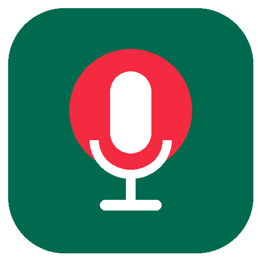
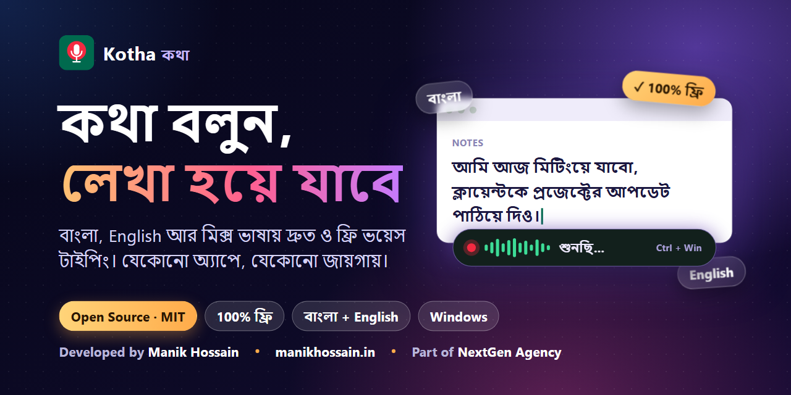
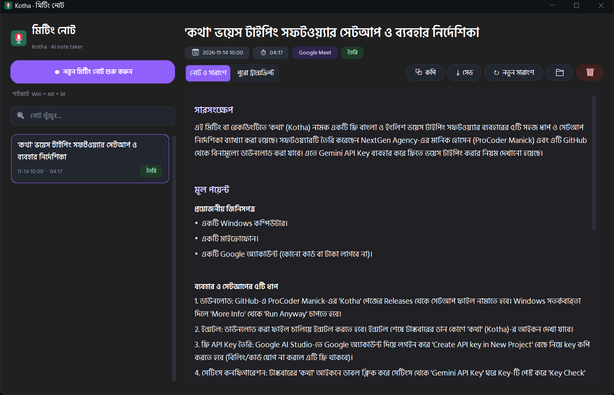
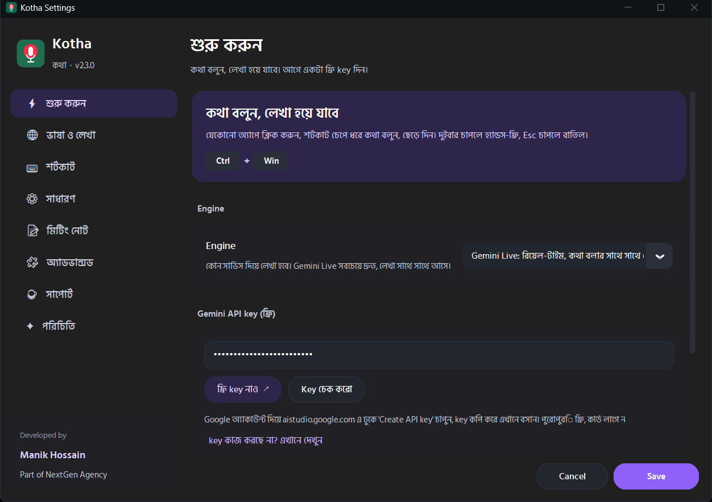
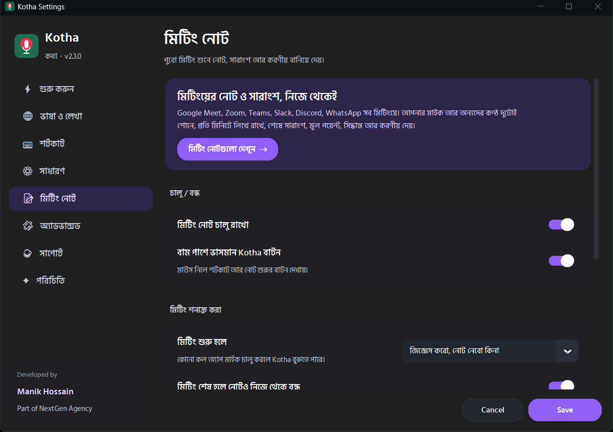
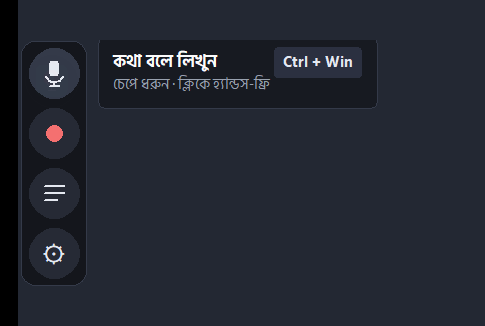
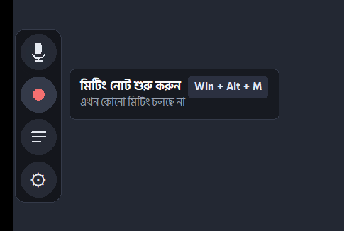
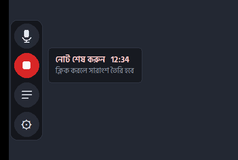
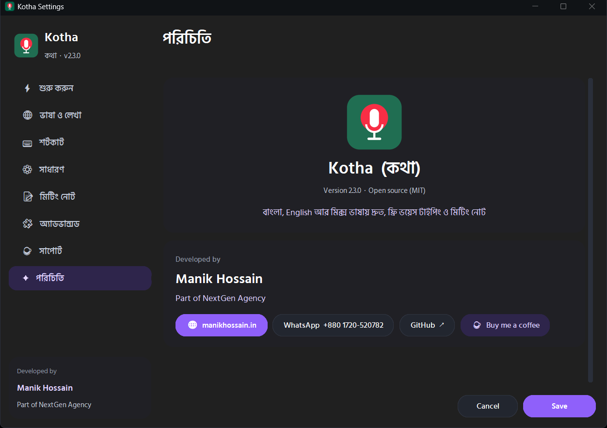

<div align="center">



# Kotha (কথা)

### কথা বলুন, লেখা হয়ে যাবে।
**Free, open-source voice typing and AI meeting notes for Bangla, English and the mix of both. Windows and macOS.**

[](../../releases/latest/download/Kotha-Windows-Setup.exe)
[](../../releases/latest/download/Kotha-Mac-AppleSilicon.dmg)
[](../../releases/latest/download/Kotha-Mac-Intel.dmg)
[](LICENSE)



</div>

---

## What is Kotha?

Kotha does two jobs in one small app that lives next to your clock.

| | |
|---|---|
| 🎙 **Voice typing** | Click in any text box (Gmail, Word, WhatsApp Web, VS Code, anything), hold a shortcut, talk, let go. Your words are typed for you. Bangla, English, or both in one sentence. |
| 📝 **AI meeting notes** | Join Google Meet, Zoom, Teams or any call. Kotha listens to your microphone and to the other people, writes it all down, and when the meeting ends gives you a title, summary, key points, decisions and action items. |

It is **free** (you use your own free Gemini key), **open source** (MIT), and built **Bangla-first**: it understands Bangla, English and natural mixes like *"আমরা next week এ launch করবো"*.

<div align="center">

</div>

## Contents

[Download](#download) · [Quick start](#quick-start-3-minutes) · [Free Gemini key](#get-your-free-gemini-api-key) · [Voice typing](#voice-typing) · [Meeting notes](#meeting-notes) · [Floating handle](#the-floating-handle) · [Mac guide](#macos-guide) · [Settings](#settings) · [Privacy](#privacy-and-your-data) · [Troubleshooting](#troubleshooting) · [How it works](#how-it-works) · [Build](#build-from-source) · [Support](#support-kotha) · [Credits](#credits)

---

## Download

Always the newest version, straight from GitHub Releases:

| Your computer | Download | Notes |
|---|---|---|
| **Windows 10 / 11** | [**Kotha-Windows-Setup.exe**](../../releases/latest/download/Kotha-Windows-Setup.exe) | Recommended. About 23 MB. |
| Windows, with offline engine | [Kotha-Windows-Offline-Setup.exe](../../releases/latest/download/Kotha-Windows-Offline-Setup.exe) | About 77 MB. Adds an offline Whisper engine (slower, weaker for Bangla). |
| **Mac, Apple Silicon** (M1, M2, M3, M4) | [**Kotha-Mac-AppleSilicon.dmg**](../../releases/latest/download/Kotha-Mac-AppleSilicon.dmg) | macOS 11 or newer. Meeting audio needs macOS 13+. |
| **Mac, Intel** | [Kotha-Mac-Intel.dmg](../../releases/latest/download/Kotha-Mac-Intel.dmg) | macOS 11 or newer. |

Not sure about your Mac? Apple menu > **About This Mac**. "Chip: Apple M…" means Apple Silicon.
All releases and notes: [Releases page](../../releases).

> **Windows SmartScreen** may say "unknown publisher" because the installer is not code-signed. Click **More info**, then **Run anyway**.
> **Mac** will say the app is from an unidentified developer for the same reason. See the [Mac guide](#macos-guide).

## Quick start (3 minutes)

1. **Install** Kotha (Windows: run the `.exe`. Mac: open the `.dmg`, drag Kotha to Applications).
2. **Add a free Gemini key**: open Settings from the tray (Windows) or menu bar (Mac) icon, paste the key. [How to get one, 2 minutes](#get-your-free-gemini-api-key).
3. **Talk.** Click in any text box, **hold Ctrl + Win** (Mac: **hold Right Option ⌥**), speak, release.

For meeting notes, just join a call. Kotha asks *"নোট নেবো?"*. Or press **Win + Alt + M** (Mac: **Control + Option + M**).

## Get your free Gemini API key

Kotha turns speech into text with Google's Gemini. The key is free and needs no card.

1. Open **https://aistudio.google.com/apikey** and sign in with Google.
2. Click **Create API key**, then **Create API key in new project**. Copy the key.
3. In Kotha: **Settings > শুরু করুন**, paste the key into **Gemini API key**, click **Key চেক করো**. A green ✓ means it works. Click **Save**.

> **Do not add billing or a card to that project.** A key from a project with billing is not free and Kotha will show a "billing" or "credits depleted" error.

<div align="center">

</div>

**Backup key (optional):** the free Gemini tier has daily and per-minute limits. Add a free key from **https://console.groq.com/keys** in the Groq field and Kotha switches to it automatically when Gemini is busy.

## Voice typing

| Do this | What happens |
|---|---|
| **Hold** the shortcut, talk, **release** | The text is typed at your cursor. |
| **Double-tap** the shortcut | Hands-free mode. Press once more to finish. |
| **Esc** while recording | Cancels. |
| Click the 🎙 button on the [floating handle](#the-floating-handle) | Starts hands-free dictation. |

Default shortcut: **Ctrl + Win** on Windows, **Right Option ⌥** on Mac. Change it in **Settings > শর্টকাট** (presets, or press your own).
No text box focused? A small popup shows the text and it is already on your clipboard.

Good to know: Smart mode removes "um/আ/আহ", fixes self-corrections and punctuates (turn it off in **ভাষা ও লেখা**). Add names and brands to **বিশেষ শব্দ ও নাম** so they are spelled right.

## Meeting notes

<div align="center">

</div>

**What it does**

- Works with **Google Meet, Zoom, Microsoft Teams, Slack, Discord, WhatsApp, Webex** and other call apps.
- Records **your microphone** (labelled **আমি**) and **everything the computer plays**, which is the other people (**Speaker 1, Speaker 2, …**).
- Meetings of **any length**: audio is saved to disk and transcribed **every minute while the meeting runs**, so the notes are ready seconds after you stop.
- At the end you get: **title, summary, key points by topic, decisions, action items** (task, owner, due date) and open questions, in Bangla, English, or the meeting's own language. The full transcript with times and speakers is kept next to it.
- Copy the notes, save them as Markdown, re-run the summary, or delete the meeting. Everything is under the tray icon > **মিটিং নোটগুলো**.

**How to use**

1. Join your meeting. When Kotha asks **"নোট নেবো?"**, click **হ্যাঁ, নোট নাও**. Or press **Win + Alt + M**, or use the [floating handle](#the-floating-handle).
2. Talk as usual. Press the shortcut again (or the red button) when it ends. If the call app closes the call, Kotha stops by itself.
3. A card says **মিটিং নোট তৈরি হয়েছে ✓**. Click **খুলুন**.

**Detection** works by noticing that a call app is using your microphone (Windows reads this from the system's microphone-use list; Mac checks that a call app is open while the microphone is in use). Choose in Settings whether Kotha **asks**, **starts by itself**, or does nothing.

> **Be fair to others.** Tell everyone in the meeting before you record, and follow your organisation's rules. Kotha records only on your computer, and only when notes are on.

**Free-tier limits.** If Google's free quota is busy, Kotha keeps the audio, waits and retries. If something still fails, open the meeting and press **আবার প্রসেস করো**. A free Groq key as backup helps a lot.

**Limits to know:** speaker labels are by voice and can occasionally mix up two people who sound alike; the notes are an AI summary, so check important numbers and decisions; on Mac, hearing the other people needs the **Screen Recording** permission (see below).

## The floating handle

A thin line sits on the left edge of your screen, out of the way. **Hover** and it opens into round buttons. **Drag** it up or down to move it.

<div align="center">



</div>

| Button | What it does |
|---|---|
| 🎙 | Hands-free voice typing (click to start, click to finish). |
| ● / ■ | Start or stop meeting notes. Turns amber when a meeting is detected, red while recording. |
| ☰ | Open all meeting notes. |
| ⚙ | Settings. |

The line itself changes colour: grey (idle), amber (meeting found), red (recording), violet (making notes), green (dictating). Turn the handle off in **Settings > মিটিং নোট**.

## macOS guide

Kotha for Mac lives in the **menu bar** (top right), not the Dock.

**1. Install**
1. Open the `.dmg` and drag **Kotha** into **Applications**.
2. The app is not notarized by Apple (it is a free open-source build). The first time: **right-click Kotha > Open > Open**. If macOS still blocks it, run this once in Terminal and open it again:
   ```bash
   xattr -cr /Applications/Kotha.app
   ```

**2. Allow the permissions** (macOS asks on first use; Settings > সাধারণ has buttons that open each page)

| Permission | Why Kotha needs it |
|---|---|
| **Input Monitoring** | to notice when you hold the shortcut |
| **Accessibility** | to paste the text into the app you are typing in |
| **Microphone** | to hear you |
| **Screen Recording** | only for meeting notes: it is how macOS lets an app hear the sound your Mac plays (the other people). Kotha does **not** record or save your screen. |

Open **System Settings > Privacy & Security**, switch **Kotha** on in each list, then **quit and reopen Kotha** (macOS applies Screen Recording after a restart).

**3. Use it.** Hold **Right Option ⌥** to dictate. Meeting notes: **Control + Option + M**. Change both in Settings.

| Mac problem | Fix |
|---|---|
| Holding the key does nothing | Input Monitoring or Accessibility is off. Turn **Kotha** on in both, quit and reopen Kotha. |
| Only a popup shows, nothing is pasted | Accessibility is off, or no text box is focused. The text is on your clipboard: press **Cmd+V**. |
| Meeting notes only contain my voice | Turn **Kotha** on under **Screen Recording** (macOS 13 or newer), then reopen Kotha. |
| "Kotha is damaged" / "cannot be opened" | `xattr -cr /Applications/Kotha.app` in Terminal. |

Not available on Mac yet: the offline Whisper edition.

## Settings

Open from the tray / menu bar icon, the floating handle ⚙, or by double-clicking the tray icon.

| Page | What is inside |
|---|---|
| **শুরু করুন** | Engine, Gemini key (with a one-click check), Groq backup key. |
| **ভাষা ও লেখা** | Language (Auto, Bangla, English, Hindi, …), mixed-script style, Smart mode, custom words and names. |
| **শর্টকাট** | Dictation shortcut (presets or your own). |
| **সাধারণ** | Microphone, popup when no text box, restore clipboard, chunked sending, sounds, start with the computer (Mac: permission buttons). |
| **মিটিং নোট** | On/off, floating handle, detection (ask / auto / off), auto-stop, notes shortcut, notes language, keep the audio file. |
| **অ্যাডভান্সড** | Model names, OpenAI key, offline model options. |
| **সাপোর্ট** | Ways to support Kotha. |
| **পরিচিতি** | Version, developer, links. |

Engines: **Gemini Live** (default, text appears while you talk), Gemini Transcribe, Gemini Flash, Groq Whisper, OpenAI (paid), Offline Whisper (Windows offline edition).

## Privacy and your data

- **Your key, your account.** Audio goes from your computer to Google (or Groq / OpenAI if you choose them) with **your own** key. Kotha has no server and collects nothing. Free-tier audio may be used by Google to improve its products; use the offline edition for fully private dictation.
- **Notes stay on your computer:** `%APPDATA%\Kotha\meetings` (Windows) or `~/Library/Application Support/Kotha/meetings` (Mac). Raw meeting audio is **deleted after the notes are made**, unless you turn on *keep audio*.
- **No screen recording:** on Mac the Screen Recording permission is used only to receive the sound your Mac plays. Kotha does not capture or store images of your screen.
- Delete any meeting any time from the notes window (notes, transcript and audio are removed).

## Troubleshooting

| Problem | Fix |
|---|---|
| "credits depleted" / "billing" | The key's project has billing. Make a new key with **Create API key in new project**, no card. |
| "ফ্রি লিমিট শেষ" | Today's free quota is used. Add a free Groq key as backup, or try later. |
| Nothing is typed | Click inside a text box first. If none is found Kotha shows a popup and copies the text. |
| Shortcut does nothing | Another app may use it (for example Wispr Flow). Pick another in **শর্টকাট**. |
| Wrong microphone | Choose it in **সাধারণ**. |
| Notes missing the other people (Windows) | Make sure the call's sound plays through your speakers or headphones, and that the right output device is default. |
| A meeting part says "লেখা হয়নি" | Free limit or network. Open the meeting and press **আবার প্রসেস করো**. |
| Proxy / SSL / network errors | Check your proxy or VPN and your internet connection. |

Logs: `%APPDATA%\Kotha\kotha.log` (Windows), `~/Library/Application Support/Kotha/kotha.log` (Mac). Never share your API key.

## How it works

```
 microphone ──────┐                                   ┌── voice typing: text pasted at your cursor
                  ├─► Kotha (kotha.py) ── Gemini ───► ┤
 call audio ──────┘     │  (your own key)              └── meeting notes: transcript every minute,
  (loopback)            │                                  summary + key points at the end
                        └─ plat_win.py / plat_mac.py: shortcuts, paste, call detection, tray
```

- **`kotha.py`**: the app: recording, engines, meeting pipeline, windows.
- **`plat_win.py`, `plat_mac.py`**: everything OS-specific: global shortcut hook, paste keystroke, text-box detection, call detection, system-audio capture (Windows: WASAPI loopback; Mac: ScreenCaptureKit), tray helpers.
- **`ui_theme.py`**: the design system (dark theme, Windows 11 Mica glass, Hind Siliguri font, components).
- Meeting audio is recorded as two tracks (you / others), cut at quiet moments into 1-minute pieces, transcribed in parallel with speaker labels, then summarised by a stronger model. If a model is rate-limited Kotha falls back to the next one and retries.
- A self-test (`Kotha --selftest --ui`) opens every window and checks audio and detection; it runs on real Windows and macOS machines in CI.

## Build from source

**Windows:** Python 3.12 and [NSIS](https://nsis.sourceforge.io).
```bat
build.bat            :: output\Kotha-Windows-Setup.exe
build.bat offline    :: output\Kotha-Windows-Offline-Setup.exe
```
**macOS:** a Mac with Python 3.12 (python.org build, it includes Tk).
```bash
chmod +x build_mac.sh
./build_mac.sh       # output/Kotha-Mac-AppleSilicon.dmg (or Kotha-Mac-Intel.dmg)
```
No Mac? Push a tag like `v2.4.0`: the **Release** workflow builds all four files and attaches them to the GitHub release. The **Mac self-test** workflow (push a branch named `mactest/…`) runs the app on real macOS machines.

Run from source: `pip install -r requirements.txt` then `python kotha.py`.

## Support Kotha

Kotha is free, open source, and will stay that way. Building it, keeping it working and adding features like Mac and meeting notes takes time and money. If it helps you and you would like to say thanks, you can send the price of a coffee. If not, no problem at all, Kotha is for you either way. ❤

<div align="center">

**bKash · Rocket · Nagad (Personal, Send Money)**

### `+880 1650-043801`

</div>

Other ways to help, all free: **star this repo ⭐**, tell a friend or colleague, and report bugs or ideas in [Issues](../../issues).

## Contributing

Issues and pull requests are welcome. For a bug, include the steps, your Windows/macOS version, and the log lines from `kotha.log` (never your API key).

## Credits

Developed by **[Manik Hossain](https://www.manikhossain.in/)**, part of **[NextGen Agency](https://www.nextgenagency.co/)**.
Font: [Hind Siliguri](https://fonts.google.com/specimen/Hind+Siliguri) (SIL Open Font License).

<div align="center">

</div>

## License

[MIT](LICENSE)
